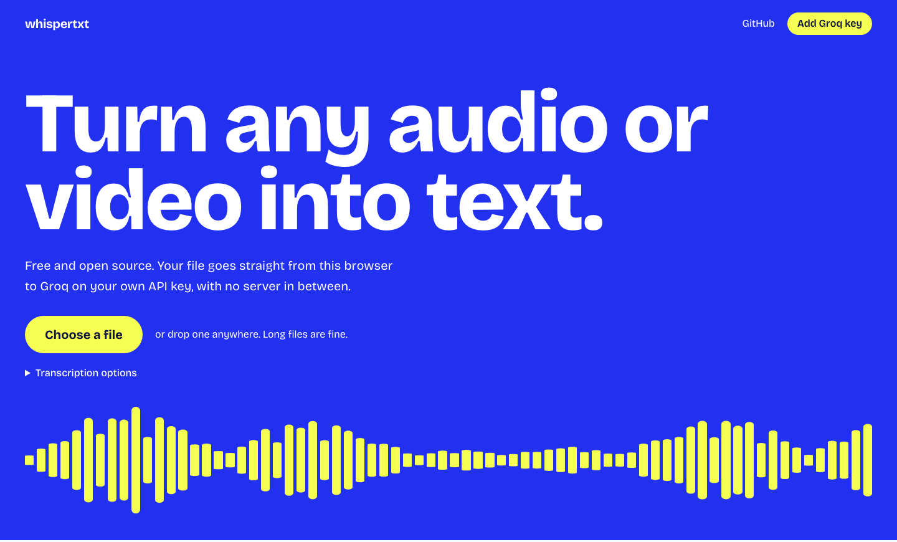

# WhisperTxt

Turn any audio or video into text, right in your browser. Free, open source, and you bring your own [Groq](https://groq.com) API key.

**Use it at [whispertxt.vercel.app](https://whispertxt.vercel.app).**



## What it does

- **Takes almost anything.** MP3, M4A, WAV, FLAC, OGG, WebM, MP4, MOV and MKV decode natively in your browser. AVI, WMV and other older formats fall back to ffmpeg.wasm, which is only downloaded when needed.
- **Handles long files.** Audio is cut into overlapping 5 minute pieces, so a three hour recording uses the same memory as a ten minute one and no word gets lost at a join.
- **Never loses progress.** Finished pieces are saved as they arrive. Hit Groq's rate limit and it waits and carries on. Reload the tab and you can continue where you stopped.
- **Follows along.** The current word lights up during playback. Click any word to jump to it.
- **Searches everything.** Find a word across all your transcripts and jump to the exact second.
- **Exports** TXT, SRT, VTT and JSON, with word level timing in the JSON.

## Privacy

There is no WhisperTxt server. The app is static files, so:

- Your audio goes directly from your browser to Groq, and to nowhere else.
- Your API key is stored in this browser's local storage and only ever sent to Groq.
- Your transcripts and files stay in this browser's IndexedDB. Clearing site data deletes them, so use **Back up all transcripts** if you care about them.

You do not have to take that on trust. [`vercel.json`](vercel.json) sets a Content Security Policy that blocks the page from connecting to anything except its own origin and `api.groq.com`, there are no analytics, and an end to end test fails if the app contacts any other host.

Groq processes your audio under [its own terms](https://groq.com/privacy-policy).

## How it works

1. A Web Worker decodes the file with [Mediabunny](https://mediabunny.dev), or [ffmpeg.wasm](https://ffmpegwasm.netlify.app) as a fallback, and resamples it to 16 kHz mono.
2. Every 5 minutes of audio becomes a chunk with 2 seconds of overlap, encoded as 32 kbps Opus (or WAV where Opus encoding is not available).
3. Up to three chunks upload to Groq at once, each asking for word and segment timestamps.
4. Timestamps are moved onto the file's timeline, and the overlaps are merged so every word is kept exactly once.

The stack is React 19, TypeScript, Vite, Tailwind CSS, TanStack Router, Dexie and Motion.

## Run it yourself

You need [Bun](https://bun.sh).

```sh
bun install
bun run dev
```

To host your own copy, import this repo into [Vercel](https://vercel.com/new). No environment variables are needed. Any static host works too: run `bun run build` and serve `dist/`, with `/t/*` rewritten to `index.html`.

## Development

```sh
bun run lint       # Biome
bun run test       # unit tests
bun run test:e2e   # browser tests on the production build, needs ffmpeg
```

The browser tests mock Groq. To run a real file through real Groq, which spends your quota:

```sh
GROQ_API_KEY=gsk_... REAL_FILE=path/to/file.mp4 bunx playwright test real
```

## Limits

- Transcription speed and quota depend on your Groq plan. See your [limits page](https://console.groq.com/settings/limits).
- Source files over 500 MB are not kept for replay. They still transcribe, but you need to drop the file again to play it after a reload.
- Some formats, such as AVI and WMV, transcribe fine but cannot play back in a browser, so they show the transcript without the player.

## License

[MIT](LICENSE)
